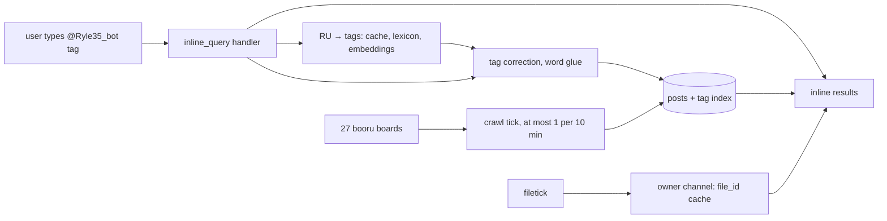

# Ryle35

[](https://t.me/Ryle35_bot)

An inline Telegram bot that searches anime image boards (boorus) without leaving the chat. Type `@Ryle35_bot long_hair` in any message box and pick a post — the query can also be in plain Russian: `@Ryle35_bot длинные волосы` finds `long_hair`.

It runs entirely on [Telegram's serverless bot platform](https://core.telegram.org/bots/serverless): JavaScript modules in a V8 isolate, an SQLite-backed database behind a query builder, HTTP through a built-in `fetch`. No server to rent, nothing to deploy except the modules themselves.

> The index includes NSFW boards, so it's 18+. AI-generated posts are filtered out on purpose, and so are AI-only boards.

## What it does

- **Inline everywhere:** works in any private chat, group, or channel through Telegram's inline mode. Multi-tag AND queries, pagination, `cache_time` to keep repeat queries cheap.
- **27 boards, 15 engines:** danbooru, gelbooru, rule34.xxx, e621, konachan, yande.re, wallhaven, rule34.world, the philomena family (derpibooru, furbooru, ponerpics, …), gallery sources (nhentai, e-hentai), art platforms (itaku, furaffinity, deviantart) and the scrolller reddit aggregator. One small adapter per engine, all in `endpoints/crawl.js`.
- **Typo-tolerant search:** query tags are corrected against each board's autocomplete API (prefix candidates, weighted votes) before the search runs. Multi-word queries get glued into real tags: `long hair` → `long_hair`, `2 girls` → `2girls`.
- **Search in Russian:** a three-layer translator turns a Russian query into English booru tags: an exact-match cache, a built-in lexicon of frequent words and phrases, and — when the lexicon comes up short — a semantic layer that embeds the query via OpenRouter and matches it against tag vectors stored in the database (int8 cosine, 512 dims). The pipeline degrades gracefully: any failure falls back to whatever the cheaper layers produced.
- **Video that survives Telegram:** external media in inline results is capped at 1 MB (gif) / 20 MB (video), and board URLs rot. A background job pre-downloads mp4s into a private owner channel, where Telegram issues a permanent `file_id`; cached videos are served first and outlive URL rot.
- **A queue that grows where users look:** searches seed the crawl queue with demand-weighted priority, capped at one tick per 10 minutes to stay inside platform limits.
- **No AI content:** posts tagged `ai_generated` and friends are dropped before they reach the database; AI-only boards are excluded entirely.

## How it fits together



## Repo layout

| Path | What it is |
|---|---|
| `tgcloud/schema.js` | Database schema (tables as named exports) |
| `tgcloud/lib/` | Shared modules: search, RU → tags translation (`ru.js`), embeddings (`embed.js`), crawl queue, tag suggest, board keys |
| `tgcloud/handlers/` | Update handlers: `inline_query`, `chosen_inline_result`, `message` |
| `tgcloud/endpoints/` | Background jobs and utilities: `crawl`, `tick`, `filetick`, `dev`, `zz_seed_vec` (tag-vector index builder) |
| `booru-sites.md` | Research notes: every board checked, its engine, and why it was kept or rejected |
| `docs/` | Platform reference (tgcloud CLI, serverless SDK) |

Module names are paths relative to `tgcloud/`. Only `.js` files there get deployed; everything else is local. Relative imports must end in `.js`, and there are no npm packages or filesystem at runtime.

## Running your own copy

1. Create a bot in [@BotFather](https://t.me/BotFather), switch **Serverless** on, grab a CLI access token, then `npx tgcloud login` in this repo.
2. `npx tgcloud push` deploys the modules; `npx tgcloud migrate` applies `tgcloud/schema.js` to the database.
3. Create `tgcloud/lib/keys.js` for the boards that need API keys (the file is gitignored but deployed with the project):

```js
export const gelbooru = { apiKey: '...' };
export const rule34xxx = { apiKey: '...' };
export const wallhaven = { apiKey: '...' };
```

4. `tgcloud/lib/config.js` holds the ID of a private channel where the bot parks mp4 files to collect `file_id`s. Make your own channel, add the bot as admin, put its chat ID there.
5. The Russian-query layer needs two extra pieces: `tgcloud/lib/aikeys.js` (gitignored) with an OpenRouter key, and a `tag_vec` index — tag embeddings built by `endpoints/zz_seed_vec.js`. Without it the bot still works: queries just fall back to the lexicon.

Board-by-board research (API shapes, rate limits, Cloudflare traps, dead ends): [booru-sites.md](booru-sites.md). Platform reference: [docs/telegram-serverless.md](docs/telegram-serverless.md) and [docs/tgcloud-sdk.md](docs/tgcloud-sdk.md).

## Status

In active use by the author on [@Ryle35_bot](https://t.me/Ryle35_bot). One caveat for forks: `endpoints/dev.js` is a dev console with destructive one-off ops and no owner check. Remove it or guard it before letting strangers use your deploy.

## License

No license yet. Ask before reusing.
